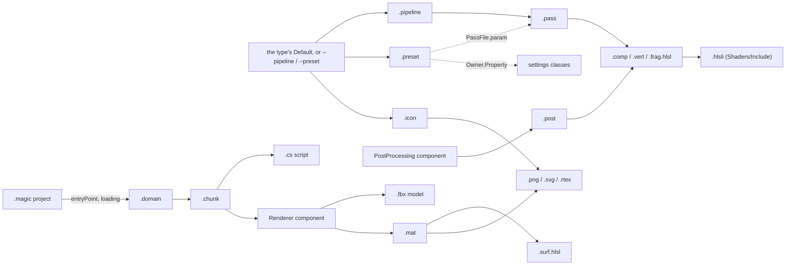

# Assets

How any asset is found, read, kept and reloaded: the engine's own, which Core and each gem keep in their `Resources/`
folder (what every project can use without shipping it), and a project's, in its `Assets/` folder, which work
exactly the same way. Each kind has a README in the part whose resources hold it:

| Kind | Type | What it is |
| --- | --- | --- |
| [Domains](Domains/README.md) | `Domain`, `Chunk` | Worlds: a `.domain` and the chunks of entities beside it ([the loading screen's](../../Gems/World/LoadingScreen/Resources/Domains/README.md) is LoadingScreen's). |
| [Fonts](../../Gems/Debug/ImGuiDebugUI/Resources/Fonts/README.md) | `Font` | Fonts for the debug UI. |
| [Icons](Icons/README.md) | `Icon` | The application's icon: the window's, and the loading screen's. |
| [Materials](Materials/README.md) | `Material` | A surface shader with values: what a model looks like. |
| [Models](Models/README.md) | `Model` | Meshes: the primitives every project has. |
| [Passes](../../Gems/Rendering/DeferredRenderer/Resources/Passes/README.md) | `Pass`, `Post` | One GPU step each: what it reads, writes, creates and runs. |
| [Pipelines](../../Gems/Rendering/DeferredRenderer/Resources/Pipelines/README.md) | `Pipeline` | Which passes run, in which stage, in which order. |
| [Presets](Presets/README.md) | `Preset` | Named sets of settings: Toaster, Default, Fancy, MeltMyGPU. |
| [Scripts](../../Gems/World/LoadingScreen/Resources/Scripts/README.md) | `Script` | Behaviours attached to entities in a chunk. |
| [Shaders](../../Gems/Rendering/DeferredRenderer/Resources/Shaders/README.md) | `Shader` | HLSL: surfaces, passes and the headers they share. Core's are the generic ones: the surface contract and the engine's surfaces, the binding macros, maths, debug text, the failure look, the fullscreen triangle, the depth-only stage, the probes. |
| [Textures](Textures/README.md) | `Texture` | Images. |

## How they fit together



What has to agree along those arrows is in each type's README: a pass's reads and writes with its shader's
bindings, a material's params with its surface's `MaterialParams`, a chunk's component names with the C# types, a
script's id with a class of the file's name.

## Finding an asset

**Roots.** The engine indexes and watches these folders, and reads one more:

| Root | Where | Watched |
| --- | --- | --- |
| Assets | `Assets/` beside the project's `.magic` file (or `--root`); a path it has wins over a gem's | yes |
| Engine resources | Core's own `Resources/` folder (this one) in a Debug build; in Release one bundle of Core's and every engine gem's, `bin/Resources/` beside the exe; there for the whole run | yes |
| Gem resources | in a Debug build each loaded gem's own `Resources/` folder, added before the gem is constructed and gone with it; in Release they are in the bundle above | yes |
| LOD cache | `Lods/` in the project's cache (`Project.Cache`: `Cache/` next to `Magic.exe`) | no |

Every file under a root is an asset, except `.meta` sidecars and `.md` files. A path both roots have (the
project's Assets and a gem's Resources) is the project's.

**Ids, not paths.** Every asset has a 64-bit id in the `.meta` beside it, and assets name each other by it:
`{ "id": 10030 }`. A file can be moved or renamed and everything that names it still finds it. Code that starts from
a name looks it up by its path relative to a root, with forward slashes: `assets.Find<Pipeline>("Pipelines/Default.pipeline")`.

**The `.meta` sidecar** is the asset class's settings, serialized:

```json
{ "id": 520, "origin": { "x": -1, "y": 0, "z": 0 } }
```

- `id`: unique across every root. A second file with an id already taken is refused with an error; an id of 0, or a
  sidecar that is not JSON, leaves the file unindexed.
- `lods`: authored levels of detail, `{ "<threshold>": id }`; they win over generated ones (see Models and Domains).
- Every `[MetaData]` property of the class, camelCase: `size`, `origin`, `usage`, …
- A file without a sidecar gets one on the next run, with a random id. To pick the id yourself (so it can be typed
  into other files before the first run), write the sidecar first.

**Engine id ranges.** The engine's own assets use small, readable ids: Textures 3 and 36, Models 512–520 and 1529,
Fonts 600, Domains 700–703, Materials 710–714, Scripts 720–721, Icons 730, Shaders 10001–10003, 10020–10023 and
10060–10075, Posts 10030–10031, Pipelines 10040, Passes 10100–10192, Presets 10300–10303 (the rest are random). The
samples use 3000–7600 and 10050–10059 (GracefulFailures, between the engine's shaders), the project template
1001–1003. A project's random ids never collide in practice; anything new in Core's or a gem's `Resources/` takes the
next free id of its range.

**Default assets.** A type's default is the file named `Default` in the folder named for the type,
`<Type>s/Default.<ext>` (or `<Type>s/Default/Default.<ext>` for an asset that is a folder, like a domain), found by
`Assets.Default<T>()`. Code names no path for it, and a project replaces one by having its own at the same path,
since the project's file comes first. The engine's:

| Path | The default for |
| --- | --- |
| `Domains/Default/Default.domain` | The world when no entry point is named, or the one named does not open: a red question mark in a black void. |
| `Materials/Default.mat` | An entity with no material, and what `summon` puts on a model. |
| `Models/Default.fbx` | A cube: what `summon` puts a material on. |
| `Textures/Default.png` | Whatever asks `Default<Texture>()` (the engine does not): a checkerboard, which `Materials/Checker.mat` samples. |
| `Icons/Default.icon` | The window's and the loading screen's icon: the mage (`Textures/Mage.svg`). |
| `Presets/Default.preset` | The preset when `--preset` names none. |
| `Pipelines/Default.pipeline` | The pipeline when `--pipeline` names none (DeferredRenderer's: the type is the renderer's). |

**Other paths the engine names in code.** These must exist under some root; each is read by the gem named, from
whichever root has it. A shader's `#include` names a path too: `Shaders/<path>`, under whichever root has it.

| Path | Gem | Used for |
| --- | --- | --- |
| `Domains/Loading/Loading.domain` | LoadingScreen | The loading screen when the project names none. |
| `Shaders/Surfaces/Pbr.surf.hlsl`, `Shaders/Surfaces/Failure.surf.hlsl` | DeferredRenderer | The default surface and the failure surface. |
| `Shaders/Include/SurfaceBindings.hlsli`, `Shaders/Include/Pass.hlsli` | DeferredRenderer | How it binds a surface (which includes Core's contract, `Shaders/Include/Surface.hlsli`) and the post contract, included in front of every surface and post. |
| `Shaders/Templates/Mesh.vert.hlsl`, `GBuffer.frag.hlsl`, `Forward.frag.hlsl` | DeferredRenderer | The mesh path a material's surface is composed into. |
| `Shaders/Passes/Fullscreen.vert.hlsl`, `Shaders/Passes/FailureOverlay.frag.hlsl` | DeferredRenderer | The fullscreen triangle, and how a broken pass shows on screen. |
| `Shaders/Test/` | DeferredRenderer | The start-up probes of the conventions. |
| `Shaders/Overlay/Overlay.vert.hlsl`, `Overlay.frag.hlsl` | ImGuiDebugUI | Drawing the debug UI. |
| `Fonts/MontserratMedium.otf` | ImGuiDebugUI | The debug UI's font. |

## Reading an asset

**The C# type comes from whoever asks.** A `Handle<Material>` reads the file as a `Material`; the extension only
matters where a loader says so (a shader's stage, `.post` vs `.pass`, `.rtex`, `.chunk`, `.cs`). How the file is
read is set by what the class derives from, else by `[AssetFormat]` on it:

| Kind | The file is | Classes |
| --- | --- | --- |
| `TextAsset` | text, in `Text` | `Shader` |
| `BinaryAsset` | bytes, in `Data` | `Chunk` |
| `[AssetFormat(Json)]` | the class, serialized; the sidecar's `[MetaData]` values are copied over it | `Material`, `Pass`, `Post`, `Pipeline`, `Preset`, `Domain`, `Icon`, `RenderTexture` |
| `[AssetFormat(Custom)]` | whatever a gem's `IAssetLoader<T>` makes of it | `Texture` (SdlImageLoader), `Model` (AssimpModelLoader; a generated model's own `.model` form is read by the asset manager), `Font` (SdlFontLoader), `Script` (CSharpScripting) |

**The JSON** (`AssetJson`, the one place JSON is read and written): camelCase keys matched case-insensitively,
enums in snake_case (`clamp_to_edge`, `rgba16_float`), vectors as `{ "x", "y", "z", "w" }`, colours as
`{ "r", "g", "b", "a" }`, handles as `{ "id": N }`, infinities by name (`"Infinity"`), comments and trailing commas
allowed, and what a type only computes (a get-only property, `Transform.Matrix`) not written.

**`"base"`.** A JSON asset can start from another of its type: `"base": { "id": N }` reads that file first and lays
this one over it, objects merged key by key, anything else replaced, so a variant says only how it differs. A base
can have its own base; a loop is an error. Editing a base reloads everything built on it.

**Loading** is asynchronous (`Assets.LoadAsync`): the file and everything it names are read on worker threads, and a
failure is an error the caller decides what to do with. The renderer never fails a frame over one: a broken asset is
drawn with the glowing failure surface and labelled where it is (Debug builds).

## Lifetime

- **Pools.** Loaded assets are kept in one pool per type, least recently used first out. The budgets, in MB, are
  the `Assets.Budgets` setting: `Chunk` 1024, `Texture` 512, `Model` 256, anything else 32. A pool over budget is
  trimmed to 90%. A budget of 0 keeps nothing of that type. A preset can change them (`"Assets.Budgets": { "Chunk": 512 }`).
- **Core keeps no reference counts.** Whoever needs an asset to outlive the pool keeps its own reference. The
  renderer does: its tables count materials, textures, meshes and passes, and give their GPU memory back when the
  last user goes.
- **Failures are remembered** until the file (or its sidecar) changes, or the gems are rebuilt, so a broken file is
  reported once, not every frame.

## Hot reload

The watcher waits for a file to settle for 300 ms, then at the start of the next frame evicts it from its pool and
publishes `AssetAdded`, `AssetModified`, `AssetMoved` or `AssetRemoved`. A change to a `.meta` counts as a change to
its asset. Who listens:

| Type | On change |
| --- | --- |
| Shader, `.hlsli` | Everything compiled from it recompiles: material pipelines, passes. |
| Pass, Post, Pipeline | Reloaded and checked again; the frame keeps running meanwhile. |
| Material, Texture | Repacked and uploaded; materials using a texture repack. |
| Domain, Chunk | The domain reopens; a global chunk respawns; a cell chunk reloads. |
| Model | Not live: a warning says to remove and re-add its entities. |
| Script | Not from the file: rebuild the dll that compiles it (the gems reload). |
| Preset, Font | Not live: apply the preset again (`preset Name`); restart for a font. |

## Adding an asset

**To the engine** (something every project should have): put the file in the `Resources/` folder of the part it
belongs to, in the folder named for its type (`Shaders/`, `Materials/`, …), write its `.meta` with the next id of
the type's range, and read that folder's README for what it must agree with. Core's (here) holds what is generic,
what more than one part or every project uses: the primitive models, the default domain, materials, textures, icon
and presets, the generic shaders. A gem's holds what only it reads. Shipped, every part's `Resources/` are one folder,
so no two parts may have a file at the same path.

**To a project**: put the file anywhere under the project's `Assets/` (the samples keep each domain's materials,
textures and scripts in the domain's folder). A `.meta` is minted on the first run. The `.magic` file names the
assets the engine starts from (every value is optional; the command line's `--entry-point` and `--loading` win over
it):

```json
{
    "name": "Samples",
    "gems": [ "default" ],
    "entryPoint": { "id": 3301 },
    "loading": { "id": 700 }
}
```

Scripts in C# are compiled by the project's csproj (`<Compile Include="Assets\**\*.cs" />`); another script
language is another gem that loads `Script` assets.

**From a gem**: a gem adds asset *types*, not files. It can declare an `Asset` subclass (`Assets` is told of it as
the gem loads, as an `ITypeRegistrar`; of Core's own types before any gem), an `IAssetLoader<T>` for a file format,
an `ILODGenerator<T>` and a budget name. The files it needs itself live in its own `Resources/` folder (a renderer's
shaders, a loading screen's domain); a project's live in its `Assets/`.
